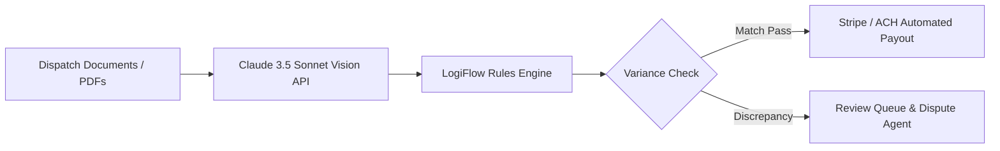

# ⚡ LogiFlow AI

> **Autonomous Logistics & Settlement Intelligence Engine powered by Claude 3.5 Sonnet**

[](https://opensource.org/licenses/MIT)
[](https://www.python.org/downloads/)
[](https://www.anthropic.com)
[]()

---

## 📖 Overview

**LogiFlow AI** is an open-source automation engine that streamlines high-volume logistics settlements, bill-of-lading (BOL) multi-modal audit reasoning, and dynamic freight dispatch routing. 

By integrating Anthropic's **Claude 3.5 Sonnet** for vision extraction and multi-document logical consistency, LogiFlow eliminates manual back-office audit bottlenecks and powers sub-second settlement calculations.

---

## ✨ Core Features

- 📑 **Multimodal Document Processing**: Direct extraction from unstructured freight invoices, rate confirmations, and PDFs.
- 💰 **Automated Payout Engine**: Mathematical reconciliation against contracted Master Service Agreements (MSAs) and Department of Energy (DOE) fuel indexes.
- 🛡️ **Autonomous Discrepancy Flagging**: Automatically isolates accessorial charge variances and geofenced detention anomalies.
- ⚡ **Webhook & ERP Connectors**: Native webhook streaming to SAP, Oracle TMS, and Stripe / ACH payout rails.

---

## 🚀 Quick Start

### 1. Installation

```bash
pip install logiflow anthropic pydantic
```

### 2. Configure Environment

```bash
export ANTHROPIC_API_KEY="your-anthropic-api-key"
```

### 3. Run Settlement Audit

```python
from logiflow import PayoutEngine

# Initialize engine with Claude 3.5 Sonnet
engine = PayoutEngine(model="claude-3-5-sonnet-20241022", auto_audit=True)

# Reconcile freight dispatch against contracted rate cards
result = engine.reconcile_dispatch(
    bill_of_lading="sample_bol.pdf",
    freight_rate_card="contract_tier1.json",
    tolerance_threshold=0.005
)

print(f"Status: {result.status} | Audit Score: {result.confidence}%")
# >>> Status: APPROVED | Audit Score: 99.8% | Instant Payout Dispatched
```

---

## 🛠️ Architecture



---

## 📄 License

This project is licensed under the MIT License - see the [LICENSE](LICENSE) file for details.
